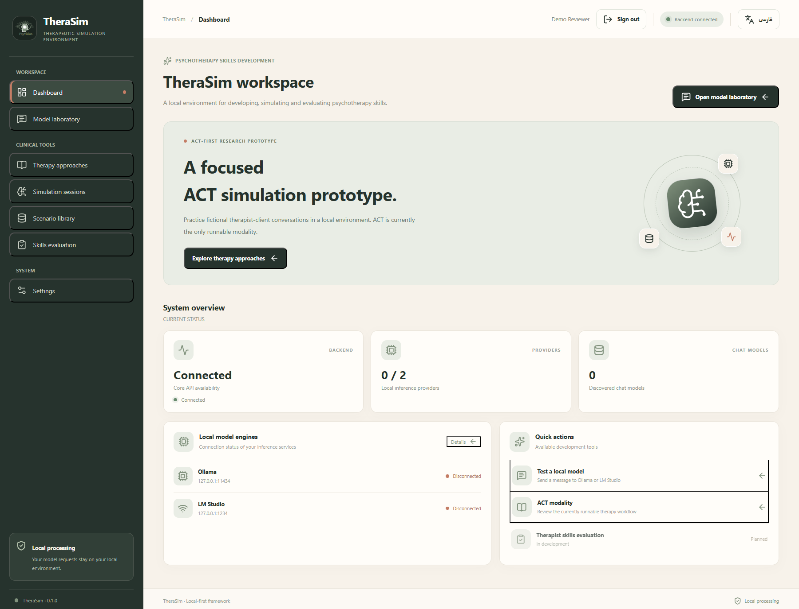
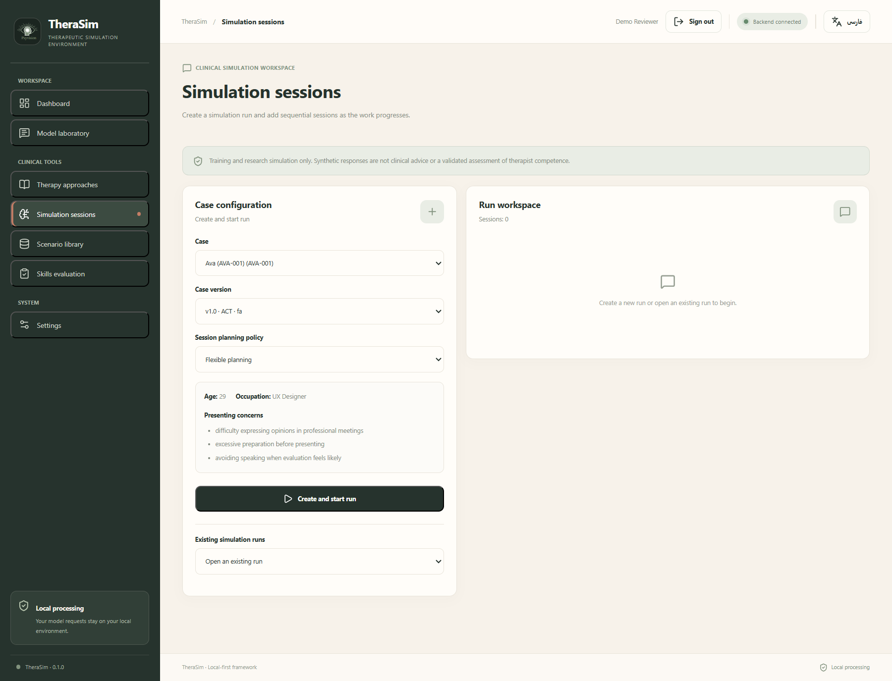
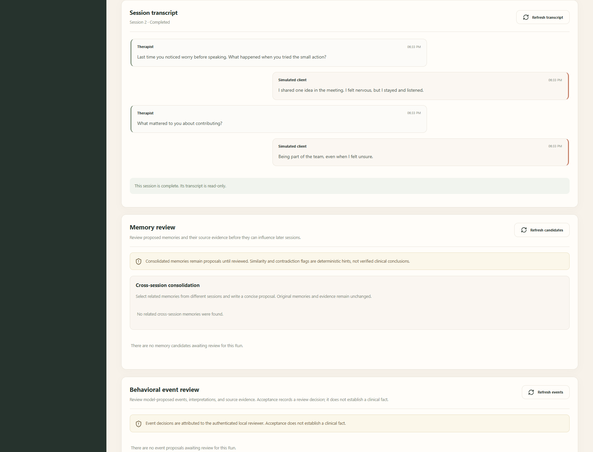
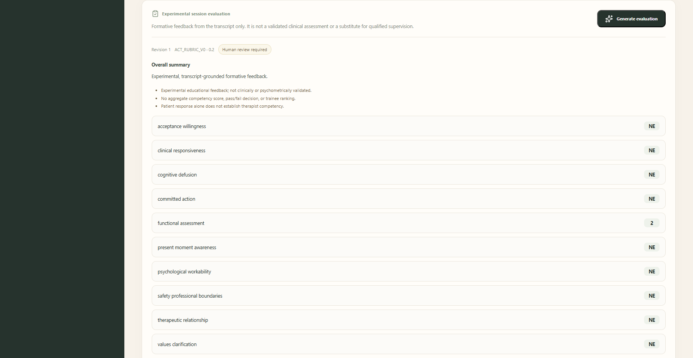
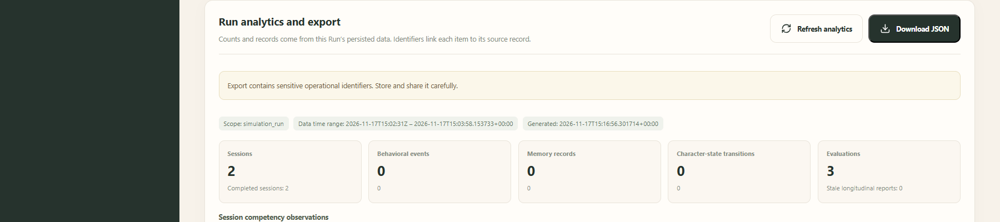

[English](#english) | [فارسی](#persian)

# TheraSim

<a id="english"></a>
## English

**A local-first research and educational prototype for psychotherapy-skills simulation**

TheraSim is an experimental application for rehearsing therapist-client conversations with fictional cases. It combines a FastAPI backend, a React interface, SQLite persistence, and optional local language-model providers.

> **Use synthetic data only.** TheraSim is not psychotherapy, diagnosis, clinical advice, professional supervision, therapist certification, or a validated measure of competence. It is not a clinical product.

### Purpose and status

The project explores whether fictional conversations, explicit information boundaries, longitudinal records, and transcript-linked formative feedback can support skills practice and software research. The current implementation is a prototype; it does not demonstrate improved clinical outcomes.

The application supports a fictional ACT workflow. **Acceptance and Commitment Therapy (ACT) is the only runnable modality.** Other approaches shown in the interface are roadmap categories, not executable therapy modules. The `v0.2.0` GitHub source release is a preparation target and has not been published or tagged.

### Implemented capabilities

- Create cases, runs, and sequential sessions; there is no universal session-count cap. Completed transcripts are read-only.
- Generate fictional patient responses through a configured local Ollama or LM Studio service. A local model is required for patient replies and evaluator generation; the application can start without one.
- Record review-gated memory, behavioral-event, character-state, and treatment-plan proposals with transcript provenance. Retrieval and cross-session suggestions use limited deterministic signals; they do not establish psychological realism.
- Create experimental ACT session and longitudinal evaluator reports when a compatible local model is configured. Reports preserve rubric and transcript references, require human review, and do not establish that evidence semantically supports a rating.
- Review versioned treatment plans and propose evidence-linked revisions. Guidance is limited to available evidence; autonomous treatment adaptation and intervention selection are not implemented.
- Inspect persisted run counts and rubric-compatible raw observations. Charts and exports are exploratory descriptions, not validated competency trends or clinical outcomes.

### Application screenshots

All examples below use fictional synthetic demonstration data. The screenshots are genuine captures of the running interface. The capture environment intentionally left model providers disconnected; no model was invoked. Evaluation and analytics examples are fixture-backed UI demonstrations, not model-performance or clinical evidence.



*Dashboard. Local inference providers were intentionally disconnected for this capture.*



*Simulation workspace. The fictional case profile is demonstration data.*



*Session transcript. The dialogue is synthetic fixture data, not a model response or clinical record.*



*Session evaluation. Fixture output for interface demonstration only; human review is required.*



*Run analytics. Descriptive fixture counts only; no competency trend or clinical outcome is established.*

### Architecture

```text
React + TypeScript + Vite
            |
       FastAPI /api/v1
            |
 application services, agents, repositories
       |                         |
operational SQLite       restricted case-vault SQLite
            |
 optional local Ollama / LM Studio provider
```

The backend uses Python, FastAPI, Pydantic, SQLite, and versioned migrations. The frontend is a React and TypeScript application. The operational database and restricted case vault are logically separated, not encrypted from other users or processes on the same device. Local model access uses an OpenAI-compatible client; TheraSim does not require a TheraSim-hosted model API.

### Installation and execution

**Windows development launcher:** install Python 3.11+ and Node.js LTS, then run `START_THERASIM.bat` from the repository root. The launcher offers setup for missing dependencies, initializes local databases without resetting existing data, and opens `http://127.0.0.1:5173`. On first use, create the single local reviewer account with a password of at least 12 characters. Use `STOP_THERASIM.bat` to stop only processes owned by the launcher.

Clean-machine installation has not been verified. Initial dependency installation or model downloads may require internet access; this project does not claim a fully air-gapped installation.

**Manual development setup** from PowerShell:

```powershell
py -3 -m venv .venv
.\.venv\Scripts\python.exe -m pip install -r backend\requirements-lock.txt
Set-Location frontend
npm ci
```

Initialize the databases and start the backend in one terminal:

```powershell
Set-Location backend
..\.venv\Scripts\python.exe -m app.persistence.cli
..\.venv\Scripts\python.exe -m uvicorn app.main:app --host 127.0.0.1 --port 8000
```

Start the frontend in a second terminal:

```powershell
Set-Location frontend
npm run dev -- --host 127.0.0.1
```

For Ollama, configure the process environment before starting the backend; LM Studio can be configured similarly. `.env` files are not automatically loaded:

```powershell
$env:THERASIM_LLM_PROVIDER = "ollama"
$env:OLLAMA_BASE_URL = "http://127.0.0.1:11434/v1"
$env:OLLAMA_MODEL = "your-installed-model"
```

Backend tests run from `backend` with `..\.venv\Scripts\python.exe -m pytest -q`. Frontend checks run from `frontend` with `npm run lint` and `npm run build`. A frontend component-test runner is not configured.

### Privacy, security, and scientific limitations

- Use only fictional and synthetic data; do not enter real client or patient information.
- Development services bind to loopback by default. Local model requests go to the configured provider, but local-first operation is not a guarantee of full offline installation or secure deployment.
- The single local reviewer account is not a multi-user authorization system. Password recovery, multi-user roles, automated retention, and encryption of live SQLite databases at rest are not implemented. Optional encrypted backups protect backup copies only.
- Analytics exports omit transcript and case text but contain operational identifiers; review them before sharing.
- ACT rubrics and evaluators are experimental. Exact transcript-reference checks do not prove semantic evidence support, evaluator reliability, clinical validity, or psychometric validity. Reports require human review and must not be used for certification.
- Treatment plans are not autonomously adapted from longitudinal progress. Memory and character-state proposals remain subject to review and are not validated psychological measurements.
- Complete English/Persian localization, RTL and responsive/accessibility verification, clean-machine installation validation, and Windows desktop packaging remain incomplete or unimplemented.

See the [implementation baseline](docs/IMPLEMENTATION_BASELINE.md), [security boundaries](docs/SECURITY_BOUNDARIES.md), [system architecture](docs/SYSTEM_ARCHITECTURE.md), and [backup/restore guide](docs/BACKUP_RESTORE.md) for details.

### License and citation

`LICENSE.md` applies CC BY 4.0 to the original documentation and research materials identified there; **it does not license executable source code**. Unless a separate software license is introduced, source code remains under the copyright holder's exclusive rights. Third-party dependencies and materials retain their own licenses.

Cite the project using [`CITATION.cff`](CITATION.cff). The published Zenodo `v0.1.0` record is a documentation-only archive ([version DOI: 10.5281/zenodo.24244882](https://doi.org/10.5281/zenodo.24244882); [concept DOI: 10.5281/zenodo.24244881](https://doi.org/10.5281/zenodo.24244881)). It is not an executable source release. No Zenodo `v0.2.0` deposit or GitHub source release has been published.

### Project links

- [GitHub repository](https://github.com/mohammadmahdialmasi/TheraSim)
- [Changelog](CHANGELOG.md) · [Release checklist](docs/RELEASE_CHECKLIST.md)
- [MVP decisions](docs/MVP_DECISIONS.md) · [Security boundaries](docs/SECURITY_BOUNDARIES.md)
- [Documentation license](LICENSE.md) · [Copyright notice](COPYRIGHT.md) · [Citation metadata](CITATION.cff)
- [Zenodo concept record](https://doi.org/10.5281/zenodo.24244881)
- [Report an issue](https://github.com/mohammadmahdialmasi/TheraSim/issues)

---

<a id="persian"></a>
## فارسی

**نمونهٔ اولیهٔ پژوهشی و آموزشیِ محلی برای شبیه‌سازی مهارت‌های روان‌درمانی**

TheraSim نرم‌افزاری آزمایشی برای تمرین گفت‌وگو میان درمانگر و مراجعان کاملاً داستانی است. این پروژه یک بک‌اند FastAPI، رابط کاربری React، ذخیره‌سازی SQLite و امکان استفاده از ارائه‌دهندگان محلی مدل زبانی را ترکیب می‌کند.

> **فقط از داده‌های ساختگی استفاده کنید.** TheraSim روان‌درمانی، تشخیص، توصیهٔ بالینی، نظارت حرفه‌ای، گواهی صلاحیت درمانگر یا سنجهٔ معتبر مهارت درمانگری ارائه نمی‌کند و محصول بالینی نیست.

### هدف و وضعیت پروژه

این پروژه بررسی می‌کند که آیا گفت‌وگوهای داستانی، مرزبندی روشن اطلاعات، ثبت پیوستگی میان جلسات و بازخورد تکوینیِ متصل به رونوشت می‌توانند به تمرین مهارت‌ها و پژوهش نرم‌افزاری کمک کنند یا نه. پیاده‌سازی فعلی نمونهٔ اولیه است و بهبود پیامدهای بالینی را نشان نمی‌دهد.

برنامه از یک جریان کاری داستانی مبتنی بر درمان مبتنی بر پذیرش و تعهد پشتیبانی می‌کند. **ACT تنها رویکرد درمانیِ قابل اجرا در نسخهٔ فعلی است.** رویکردهای دیگری که در رابط دیده می‌شوند دسته‌های احتمالیِ آینده‌اند، نه ماژول‌های درمانیِ اجرایی. انتشار منبع در GitHub با هدف `v0.2.0` در مرحلهٔ آماده‌سازی است و هنوز منتشر یا برچسب‌گذاری نشده است.

### قابلیت‌های پیاده‌سازی‌شده

- ایجاد پرونده، اجرای شبیه‌سازی و جلسات پیاپی؛ سقف عمومی برای تعداد جلسات وجود ندارد. رونوشت جلسهٔ تکمیل‌شده فقط‌خواندنی است.
- تولید پاسخ مراجع داستانی با سرویس محلی Ollama یا LM Studio که پیکربندی شده باشد. برای پاسخ‌های مراجع و تولید ارزیابی، مدل محلی لازم است؛ برنامه بدون مدل نیز اجرا می‌شود.
- ثبت پیشنهادهای حافظه، رویدادهای رفتاری، وضعیت شخصیت و طرح درمان که به رونوشت مستند شده و نیازمند بازبینی انسانی‌اند. بازیابی و پیشنهادهای میان‌جلسه‌ای از نشانه‌های قطعی و محدود استفاده می‌کنند و واقع‌گرایی روان‌شناختی را اثبات نمی‌کنند.
- تولید گزارش‌های آزمایشی ارزیاب جلسه و ارزیابی طولی ACT، در صورت پیکربندی مدل محلی سازگار. گزارش‌ها پیوند به رونوشت و نسخهٔ rubric را نگه می‌دارند، به بازبینی انسانی نیاز دارند و ثابت نمی‌کنند که شواهد از نظر معنایی یک امتیاز را پشتیبانی می‌کنند.
- بررسی طرح‌های نسخه‌بندی‌شدهٔ درمان و پیشنهاد اصلاح‌های مستند به شواهد. راهنمایی به شواهد موجود محدود است؛ انطباق خودکار درمان و انتخاب مداخلهٔ درمانی پیاده‌سازی نشده است.
- مشاهدهٔ شمارش‌های ذخیره‌شدهٔ هر اجرا و داده‌های خامِ سازگار با rubric. نمودارها و خروجی‌ها توصیفی و اکتشافی‌اند، نه روند معتبر مهارت یا پیامد بالینی.

### تصاویر برنامه

همهٔ نمونه‌ها از داده‌های ساختگی و داستانی استفاده می‌کنند و تصاویر، عکس‌های واقعی از رابط در حال اجرا هستند. برای ثبت تصاویر، ارائه‌دهندگان مدل عمداً قطع بودند و هیچ مدلی فراخوانی نشد. نمونه‌های ارزیابی و تحلیل بر پایهٔ داده‌های آزمایشیِ ثابت‌اند و شاهدی دربارهٔ عملکرد مدل یا نتیجهٔ بالینی نیستند.


*داشبورد؛ اتصال به مدل محلی برای ثبت تصویر عمداً غیرفعال بود.*


*فضای شبیه‌سازی؛ مشخصات پروندهٔ داستانی صرفاً دادهٔ نمایشی است.*


*رونوشت جلسه؛ گفت‌وگو دادهٔ ساختگیِ آزمایشی است، نه پاسخ مدل یا پروندهٔ بالینی.*


*ارزیابی جلسه؛ خروجی ثابت برای نمایش رابط است و به بازبینی انسانی نیاز دارد.*


*تحلیل اجرا؛ فقط شمارش‌های توصیفیِ دادهٔ نمایشی است و روند مهارت یا پیامد بالینی را اثبات نمی‌کند.*

### معماری

```text
رابط React + TypeScript + Vite
            |
       FastAPI /api/v1
            |
 سرویس‌های برنامه، عامل‌ها و مخزن‌های داده
       |                         |
SQLite عملیاتی       SQLite جداگانه برای پرونده‌های محدود
            |
 ارائه‌دهندهٔ محلی Ollama / LM Studio (اختیاری)
```

بک‌اند با Python، FastAPI، Pydantic، SQLite و مهاجرت‌های نسخه‌بندی‌شده ساخته شده است. رابط کاربری React و TypeScript است. پایگاه دادهٔ عملیاتی و مخزن محدود پرونده‌ها از نظر منطقی جدا هستند، اما در برابر کاربران یا فرایندهای دیگر همان دستگاه رمزنگاری نشده‌اند. دسترسی مدل محلی از طریق کلاینت سازگار با OpenAI انجام می‌شود؛ TheraSim به API میزبانی‌شدهٔ مدل توسط خود پروژه نیاز ندارد.

### نصب و اجرا

**راه‌انداز توسعه در ویندوز:** Python نسخهٔ 3.11 یا جدیدتر و Node.js LTS را نصب کنید و از ریشهٔ مخزن `START_THERASIM.bat` را اجرا کنید. راه‌انداز برای وابستگی‌های نصب‌نشده گزینهٔ آماده‌سازی ارائه می‌دهد، پایگاه‌دادهٔ محلی را بدون بازنشانی دادهٔ موجود مقداردهی می‌کند و نشانی `http://127.0.0.1:5173` را باز می‌کند. در نخستین اجرا، حساب تک‌کاربرهٔ محلی را با گذرواژه‌ای حداقل ۱۲ نویسه‌ای بسازید. برای توقف فقط فرایندهای متعلق به راه‌انداز، `STOP_THERASIM.bat` را اجرا کنید.

نصب روی دستگاه پاک راستی‌آزمایی نشده است. نصب اولیهٔ وابستگی‌ها یا دریافت مدل ممکن است به اینترنت نیاز داشته باشد؛ پروژه ادعای نصب کاملاً بدون اینترنت ندارد.

**آماده‌سازی دستی توسعه** در PowerShell:

```powershell
py -3 -m venv .venv
.\.venv\Scripts\python.exe -m pip install -r backend\requirements-lock.txt
Set-Location frontend
npm ci
```

در یک پنجرهٔ ترمینال، پایگاه‌داده را آماده و بک‌اند را اجرا کنید:

```powershell
Set-Location backend
..\.venv\Scripts\python.exe -m app.persistence.cli
..\.venv\Scripts\python.exe -m uvicorn app.main:app --host 127.0.0.1 --port 8000
```

در پنجرهٔ دوم، فرانت‌اند را اجرا کنید:

```powershell
Set-Location frontend
npm run dev -- --host 127.0.0.1
```

برای Ollama، متغیرهای محیطی فرایند را پیش از اجرای بک‌اند تنظیم کنید؛ LM Studio نیز به شکل مشابه قابل تنظیم است. فایل‌های `.env` به‌طور خودکار بارگذاری نمی‌شوند:

```powershell
$env:THERASIM_LLM_PROVIDER = "ollama"
$env:OLLAMA_BASE_URL = "http://127.0.0.1:11434/v1"
$env:OLLAMA_MODEL = "your-installed-model"
```

برای اجرای آزمون‌های بک‌اند، از پوشهٔ `backend` دستور `..\.venv\Scripts\python.exe -m pytest -q` را اجرا کنید. بررسی‌های فرانت‌اند از پوشهٔ `frontend` با `npm run lint` و `npm run build` انجام می‌شوند. در حال حاضر اجراکنندهٔ آزمون خودکار برای اجزای فرانت‌اند پیکربندی نشده است.

### حریم خصوصی، امنیت و محدودیت‌های علمی

- فقط از داده‌های داستانی و ساختگی استفاده کنید؛ اطلاعات واقعی مراجع یا بیمار را وارد نکنید.
- سرویس‌های توسعه به‌طور پیش‌فرض به loopback متصل می‌شوند. درخواست‌های مدل محلی به ارائه‌دهندهٔ پیکربندی‌شده فرستاده می‌شوند؛ محلی‌بودن به معنی نصب کاملاً آفلاین یا استقرار امن نیست.
- حساب بازبین محلی، سامانهٔ مجوزدهی چندکاربره نیست. نقش‌های چندکاربره، بازیابی گذرواژه، نگهداری خودکار داده و رمزنگاری پایگاه‌داده‌های SQLite زنده در حالت سکون پیاده‌سازی نشده‌اند. رمزنگاری اختیاری فقط نسخهٔ پشتیبان را محافظت می‌کند.
- خروجی تحلیل، متن رونوشت یا پرونده را شامل نمی‌شود، اما شناسه‌های عملیاتی دارد؛ پیش از اشتراک‌گذاری آن را بازبینی کنید.
- rubricها و ارزیاب‌های ACT آزمایشی‌اند. بررسی دقیق ارجاع به رونوشت، پشتیبانی معناییِ شواهد، پایایی ارزیاب، اعتبار بالینی یا اعتبار روان‌سنجی را ثابت نمی‌کند. گزارش‌ها نیازمند بازبینی انسانی‌اند و نباید برای گواهی صلاحیت استفاده شوند.
- طرح درمان به‌طور خودکار بر اساس پیشرفت طولی تغییر نمی‌کند. پیشنهادهای حافظه و وضعیت شخصیت نیازمند بازبینی‌اند و سنجه‌های روان‌شناختیِ معتبر نیستند.
- بومی‌سازی کامل فارسی/انگلیسی، اعتبارسنجی راست‌به‌چپ و دسترس‌پذیری واکنش‌گرا، نصب روی دستگاه پاک و بسته‌بندی دسکتاپ ویندوز ناقص یا پیاده‌سازی‌نشده‌اند.

برای جزئیات به [مبنای پیاده‌سازی](docs/IMPLEMENTATION_BASELINE.md)، [مرزهای امنیتی](docs/SECURITY_BOUNDARIES.md)، [معماری سامانه](docs/SYSTEM_ARCHITECTURE.md) و [راهنمای پشتیبان‌گیری و بازیابی](docs/BACKUP_RESTORE.md) مراجعه کنید.

### مجوز و استناد

مجوز `LICENSE.md`، مجوز CC BY 4.0 را فقط برای مستندات و مواد پژوهشیِ اصیلِ مشخص‌شده در آن اعمال می‌کند؛ **این مجوز کد اجرایی را پوشش نمی‌دهد**. تا زمانی که مجوز نرم‌افزاری جداگانه‌ای معرفی نشود، حقوق کد منبع برای دارندهٔ حق نشر محفوظ است. وابستگی‌ها و مواد اشخاص ثالث تابع مجوزهای خود هستند.

برای استناد از [`CITATION.cff`](CITATION.cff) استفاده کنید. رکورد منتشرشدهٔ Zenodo با نسخهٔ `v0.1.0` فقط آرشیوی از مستندات است ([DOI نسخه: 10.5281/zenodo.24244882](https://doi.org/10.5281/zenodo.24244882)، [DOI مفهومی: 10.5281/zenodo.24244881](https://doi.org/10.5281/zenodo.24244881)) و انتشار اجراییِ کد منبع نیست. نسخهٔ `v0.2.0` نه در Zenodo سپرده شده و نه به‌عنوان انتشار منبع GitHub منتشر شده است.

### پیوندهای پروژه

- [مخزن GitHub](https://github.com/mohammadmahdialmasi/TheraSim)
- [تاریخچهٔ تغییرات](CHANGELOG.md) · [چک‌لیست انتشار](docs/RELEASE_CHECKLIST.md)
- [تصمیم‌های MVP](docs/MVP_DECISIONS.md) · [مرزهای امنیتی](docs/SECURITY_BOUNDARIES.md)
- [مجوز مستندات](LICENSE.md) · [اطلاعیهٔ حق نشر](COPYRIGHT.md) · [فرادادهٔ استناد](CITATION.cff)
- [رکورد مفهومی Zenodo](https://doi.org/10.5281/zenodo.24244881)
- [گزارش مشکل](https://github.com/mohammadmahdialmasi/TheraSim/issues)

[English](#english) | [فارسی](#persian)
