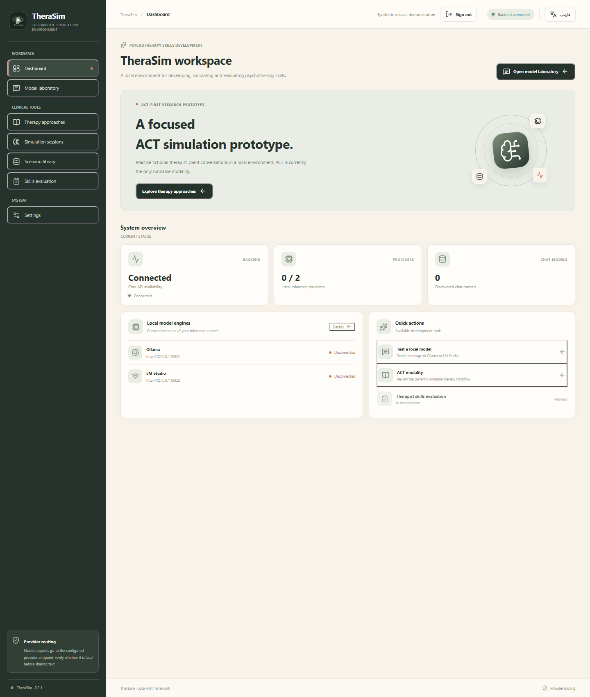
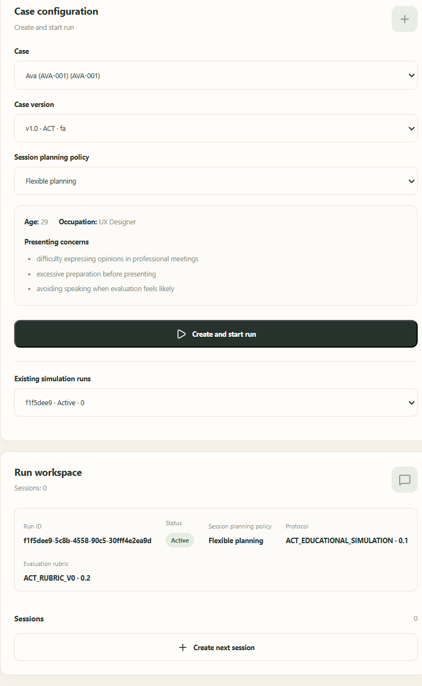
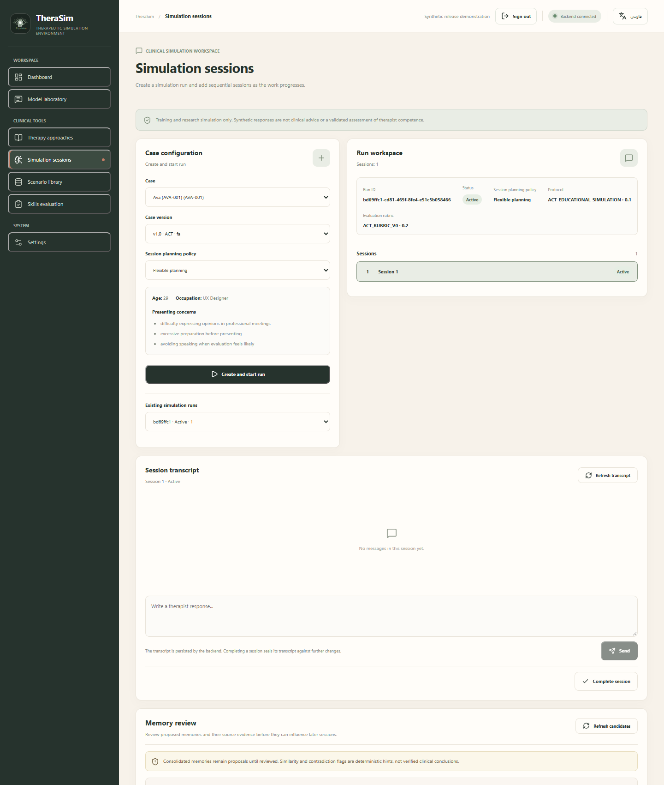
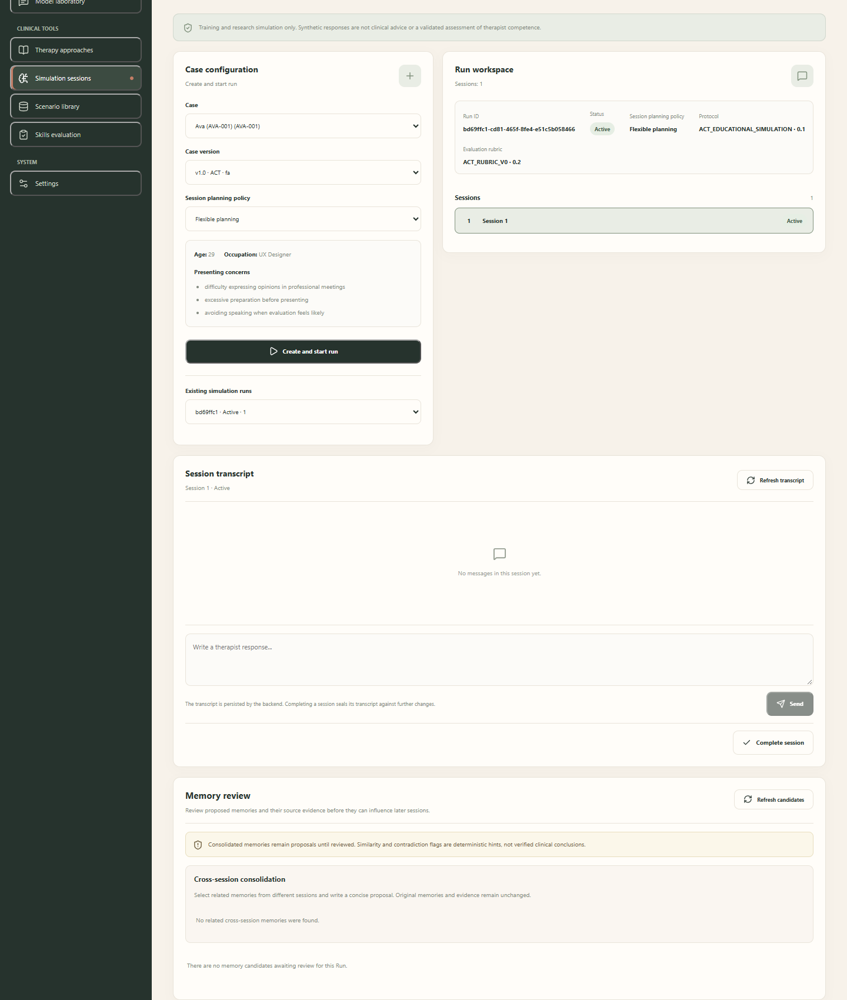
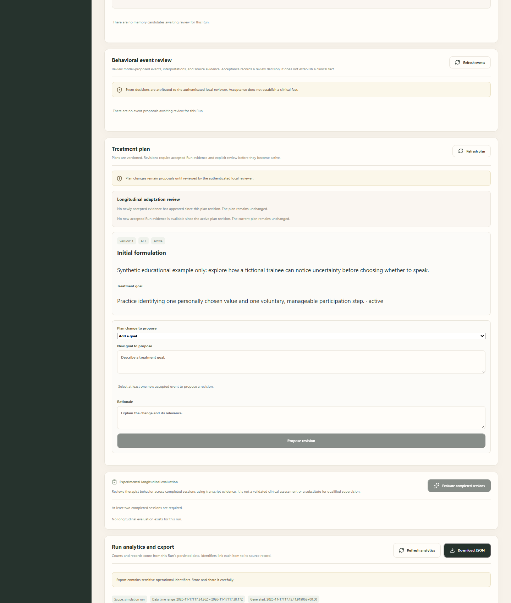
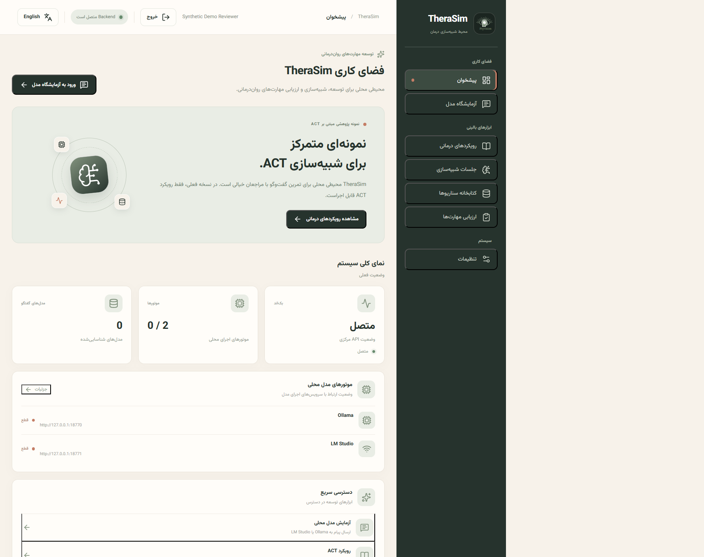
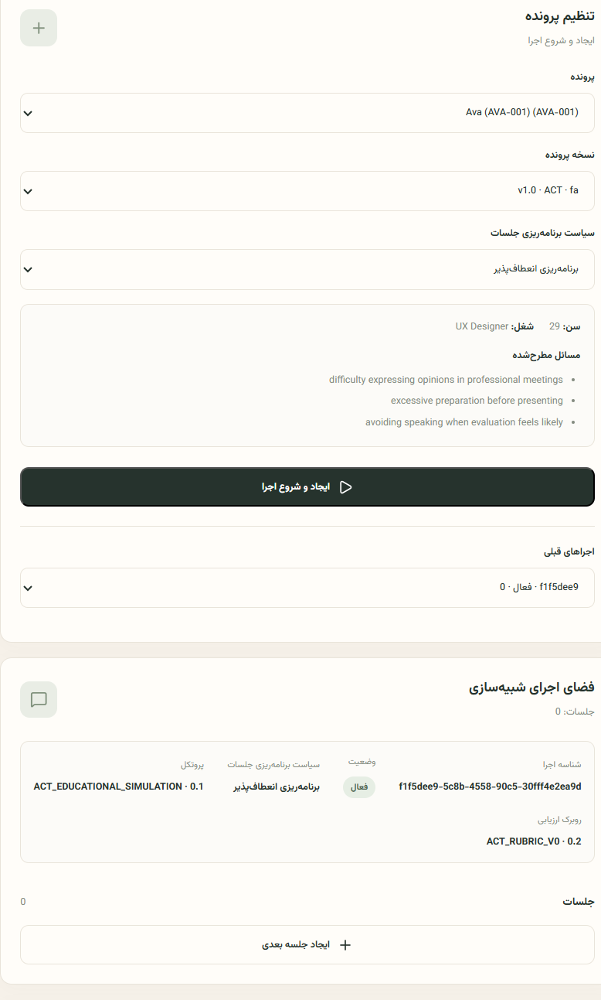
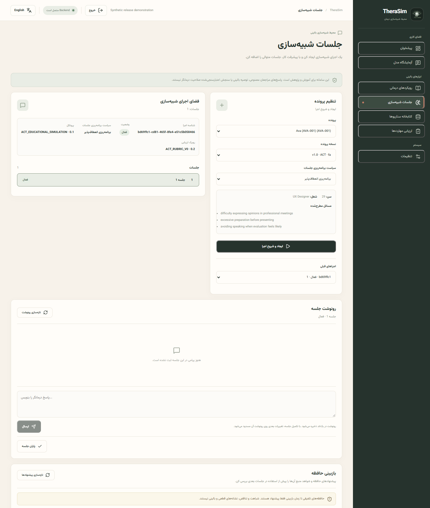
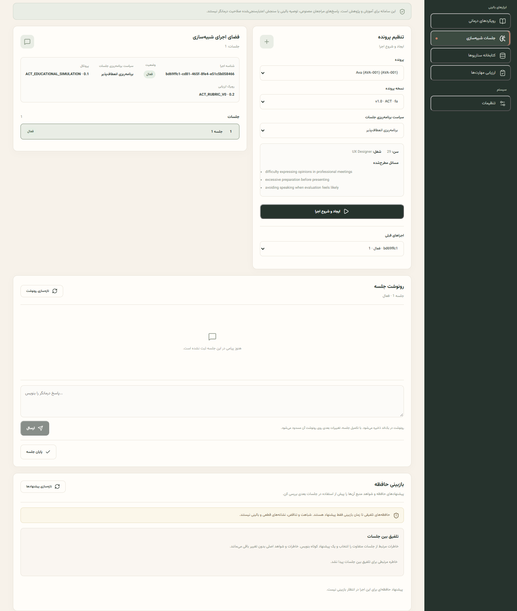
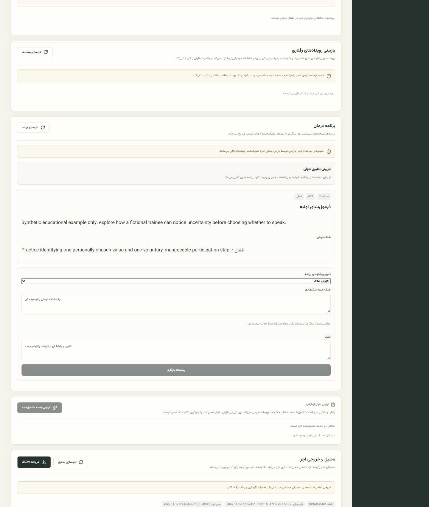

[English](#english) | [فارسی](#persian)

# TheraSim

<a id="english"></a>
## English

**A local-first research and educational prototype for psychotherapy-skills simulation**

TheraSim is an experimental application for rehearsing therapist-client conversations with fictional cases. It combines a FastAPI backend, a React interface, SQLite persistence, and optional Ollama/LM Studio-compatible model endpoints. Endpoints are usually local, but the application does not enforce that a configured endpoint is on the same device.

> **Use synthetic data only.** TheraSim is not psychotherapy, diagnosis, clinical advice, professional supervision, therapist certification, or a validated measure of competence. It is not a clinical product.

### Purpose and status

The project explores whether fictional conversations, explicit information boundaries, longitudinal records, and transcript-linked formative feedback can support skills practice and software research. The current implementation is a prototype; it does not demonstrate improved clinical outcomes.

The application supports a fictional ACT workflow. **Acceptance and Commitment Therapy (ACT) is the only runnable modality.** Other approaches shown in the interface are roadmap categories, not executable therapy modules. The published GitHub Release v0.2.0 is immutable and its Windows ZIP contains an unintended migration backup. The current Windows x64 package target is `TheraSim-v0.3.0-windows-x64.zip`; v0.3.0 is a local candidate, not a public release. Check the [GitHub Releases page](https://github.com/mohammadmahdialmasi/TheraSim/releases) and use only a published asset with its matching `.sha256` file after the release workflow has passed. A local build, even with a matching checksum, is not a published release.

### Implemented capabilities

- Create cases, runs, and sequential sessions; there is no universal session-count cap. Completed transcripts are read-only.
- Generate fictional patient responses through a configured Ollama- or LM Studio-compatible service. A model endpoint is required for patient replies and evaluator generation; the application can start without one. The configured URL may be remote, so verify it before sending transcript text.
- Record review-gated memory, behavioral-event, character-state, and treatment-plan proposals with transcript provenance. Retrieval and cross-session suggestions use limited deterministic signals; they do not establish psychological realism.
- Create experimental ACT session and longitudinal evaluator reports when a compatible local model is configured. Reports preserve rubric and transcript references, require human review, and do not establish that evidence semantically supports a rating.
- Review versioned treatment plans and propose evidence-linked revisions. Guidance is limited to available evidence; autonomous treatment adaptation and intervention selection are not implemented.
- Inspect persisted run counts and rubric-compatible raw observations. Charts and exports are exploratory descriptions, not validated competency trends or clinical outcomes.

### Application screenshots

All screenshots below are genuine browser captures of the application using a fresh temporary data directory seeded only with the fictional AVA-001 case and additional synthetic demonstration records. The default local database was not opened or used. Model providers were disconnected and no model was invoked. The images document interface layout only; they are not clinical or model-performance evidence.



*Dashboard. Local inference providers were intentionally disconnected for this capture.*



*Simulation workspace. The fictional case profile is demonstration data.*



*Session workspace. The fictional run is active and its transcript is empty; no model was invoked.*



*Review workspace. The memory and event queues are empty; no model-generated proposal or acceptance decision is depicted.*



*Plan and analytics. A human-entered fictional example and descriptive run counts are shown, not outcomes or validated competency scores.*

### Architecture

```text
React + TypeScript + Vite
            |
       FastAPI /api/v1
            |
 application services, agents, repositories
       |                         |
operational SQLite       restricted case-vault SQLite
            |
 optional local Ollama / LM Studio provider
```

The backend uses Python, FastAPI, Pydantic, SQLite, and versioned migrations. The frontend is a React and TypeScript application. The operational database and restricted case vault are logically separated, not encrypted from other users or processes on the same device. Model access uses an OpenAI-compatible client to the configured provider URL; TheraSim does not require a TheraSim-hosted model API and does not restrict provider hosts to loopback.

### Installation and execution

**Windows development launcher:** install Python 3.11+ and Node.js LTS, then run `START_THERASIM.bat` from the repository root. The launcher offers setup for missing dependencies, initializes local databases without resetting existing data, and opens `http://127.0.0.1:5173`. On first use, create the single local reviewer account with a password of at least 12 characters. Use `STOP_THERASIM.bat` to stop only processes owned by the launcher.

Windows executable users should follow [INSTALL_WINDOWS.md](INSTALL_WINDOWS.md). The distributable is a non-admin, one-folder Windows x64 portable ZIP named `TheraSim-v0.3.0-windows-x64.zip`, not an installer. It binds to loopback, keeps SQLite data and logs under `%LOCALAPPDATA%\TheraSim`, and does not bundle model weights. v0.3.0 remains a local candidate; download only a published asset and its matching checksum from GitHub Releases after its workflow verification. The installation guide also explains the in-app support preview and export.

Initial dependency installation, package downloads, or optional model downloads may require internet access; this project does not claim a fully air-gapped installation.

**Manual development setup** from PowerShell:

```powershell
py -3 -m venv .venv
.\.venv\Scripts\python.exe -m pip install -r backend\requirements-lock.txt
Set-Location frontend
npm ci
```

Initialize the databases and start the backend in one terminal:

```powershell
Set-Location backend
..\.venv\Scripts\python.exe -m app.persistence.cli
..\.venv\Scripts\python.exe -m uvicorn app.main:app --host 127.0.0.1 --port 8000
```

Start the frontend in a second terminal:

```powershell
Set-Location frontend
npm run dev -- --host 127.0.0.1
```

For Ollama, configure the process environment before starting the backend; LM Studio can be configured similarly. `.env` files are not automatically loaded:

```powershell
$env:THERASIM_LLM_PROVIDER = "ollama"
$env:OLLAMA_BASE_URL = "http://127.0.0.1:11434/v1"
$env:OLLAMA_MODEL = "your-installed-model"
```

Backend tests run from `backend` with `..\.venv\Scripts\python.exe -m pytest -q`. Frontend checks run from `frontend` with `npm run lint` and `npm run build`. A frontend component-test runner is not configured.

To build and smoke-test the Windows package, see [BUILD_WINDOWS.md](BUILD_WINDOWS.md). Package verification uses an isolated temporary local data directory and synthetic account; it does not use a user's existing SQLite data.

### Privacy, security, and scientific limitations

- Use only fictional and synthetic data; do not enter real client or patient information.
- Development and packaged web services bind to loopback. Model requests go to the configured provider URL, which may be remote; inspect the endpoint before sending text. Local-first operation is not a guarantee of full offline installation or secure deployment.
- The single local reviewer account is not a multi-user authorization system. Password recovery, multi-user roles, automated retention, and encryption of live SQLite databases at rest are not implemented. Optional encrypted backups protect backup copies only.
- Analytics exports omit transcript and case text but contain operational identifiers; review them before sharing.
- ACT rubrics and evaluators are experimental. Exact transcript-reference checks do not prove semantic evidence support, evaluator reliability, clinical validity, or psychometric validity. Reports require human review and must not be used for certification.
- Treatment plans are not autonomously adapted from longitudinal progress. Memory and character-state proposals remain subject to review and are not validated psychological measurements.
- English and Persian are provided for the implemented application workflows. RTL layout and mixed-direction identifiers are handled in the interface, but comprehensive accessibility and clean-device usability verification remain incomplete.
- The Windows package uses local user data, but its usability has not been independently reviewed on a broad range of clean Windows devices. It is not an installer and does not bundle a language model.

See the [implementation baseline](docs/IMPLEMENTATION_BASELINE.md), [security boundaries](docs/SECURITY_BOUNDARIES.md), [system architecture](docs/SYSTEM_ARCHITECTURE.md), and [backup/restore guide](docs/BACKUP_RESTORE.md) for details.

### Roadmap and contribution

The current roadmap remains ACT-first. Additional therapy categories shown in the interface are planned labels only, not implemented modalities. Research, evaluation, and security gaps are documented in [MVP decisions](docs/MVP_DECISIONS.md), the [implementation baseline](docs/IMPLEMENTATION_BASELINE.md), and the [release checklist](docs/RELEASE_CHECKLIST.md). Read [CONTRIBUTING.md](CONTRIBUTING.md) before proposing changes; executable source code is not open-source licensed. See the [support](.github/SUPPORT.md), [security reporting](.github/SECURITY.md), and [community standards](CODE_OF_CONDUCT.md) policies.

### License and citation

`LICENSE.md` applies CC BY 4.0 to the original documentation and research materials identified there; **it does not license executable source code**. Unless a separate software license is introduced, source code remains under the copyright holder's exclusive rights. Third-party dependencies and materials retain their own licenses.

Cite the project using [`CITATION.cff`](CITATION.cff). The published Zenodo `v0.1.0` record is a documentation-only archive ([version DOI: 10.5281/zenodo.24244882](https://doi.org/10.5281/zenodo.24244882); [concept DOI: 10.5281/zenodo.24244881](https://doi.org/10.5281/zenodo.24244881)). It is not an executable source release. GitHub Release v0.2.0 is published; its Windows ZIP contains the unintended migration backup noted above. The v0.3.0 Windows x64 ZIP is a local candidate, not a public release. No Zenodo v0.2.0 deposit has been made.

### Project links

- [GitHub repository](https://github.com/mohammadmahdialmasi/TheraSim)
- [Changelog](CHANGELOG.md) · [v0.2.1 release notes](docs/RELEASE_NOTES_v0.2.1.md) · [Release checklist](docs/RELEASE_CHECKLIST.md) · [Security scan notes](docs/SECURITY_SCAN_NOTES.md) · [Windows installation](INSTALL_WINDOWS.md) · [Windows build](BUILD_WINDOWS.md)
- [MVP decisions](docs/MVP_DECISIONS.md) · [Security boundaries](docs/SECURITY_BOUNDARIES.md)
- [Documentation license](LICENSE.md) · [Copyright notice](COPYRIGHT.md) · [Citation metadata](CITATION.cff)
- [Contributing](CONTRIBUTING.md) · [Support](.github/SUPPORT.md) · [Security](.github/SECURITY.md) · [Code of Conduct](CODE_OF_CONDUCT.md)
- [Zenodo concept record](https://doi.org/10.5281/zenodo.24244881)
- [Report an issue](https://github.com/mohammadmahdialmasi/TheraSim/issues)

---

<a id="persian"></a>
## فارسی

**نمونهٔ اولیهٔ پژوهشی و آموزشیِ محلی برای شبیه‌سازی مهارت‌های روان‌درمانی**

TheraSim نرم‌افزاری آزمایشی برای تمرین گفت‌وگو میان درمانگر و مراجعان کاملاً داستانی است. این پروژه بک‌اند FastAPI، رابط React، ذخیره‌سازی SQLite و امکان اتصال به نشانی‌های سازگار با Ollama یا LM Studio را ترکیب می‌کند. این نشانی‌ها معمولاً محلی‌اند، اما برنامه محلی‌بودن آن‌ها را اعمال نمی‌کند.

> **فقط از داده‌های ساختگی استفاده کنید.** TheraSim روان‌درمانی، تشخیص، توصیهٔ بالینی، نظارت حرفه‌ای، گواهی صلاحیت درمانگر یا سنجهٔ معتبر مهارت درمانگری ارائه نمی‌کند و محصول بالینی نیست.

### هدف و وضعیت پروژه

این پروژه بررسی می‌کند که آیا گفت‌وگوهای داستانی، مرزبندی روشن اطلاعات، ثبت پیوستگی میان جلسات و بازخورد تکوینیِ متصل به رونوشت می‌توانند به تمرین مهارت‌ها و پژوهش نرم‌افزاری کمک کنند یا نه. پیاده‌سازی فعلی نمونهٔ اولیه است و بهبود پیامدهای بالینی را نشان نمی‌دهد.

برنامه از یک جریان کاری داستانی مبتنی بر درمان مبتنی بر پذیرش و تعهد پشتیبانی می‌کند. **ACT تنها رویکرد درمانیِ قابل اجرا در نسخهٔ فعلی است.** رویکردهای دیگری که در رابط دیده می‌شوند دسته‌های احتمالیِ آینده‌اند، نه ماژول‌های درمانیِ اجرایی. انتشار GitHub نسخهٔ ۰٫۲٫۰ منتشر و تغییرناپذیر است و ZIP ویندوز آن سهواً یک نسخهٔ پشتیبان مهاجرت را در بر دارد. هدف فعلی بستهٔ ویندوز x64 با نام `TheraSim-v0.3.0-windows-x64.zip` است؛ نسخهٔ ۰٫۳٫۰ نامزد محلی است، نه انتشار عمومی. [صفحهٔ GitHub Releases](https://github.com/mohammadmahdialmasi/TheraSim/releases) را بررسی کنید و فقط بستهٔ منتشرشده را همراه فایل `.sha256` متناظر، پس از موفقیت گردش‌کار انتشار دریافت کنید. حتی ساخت محلی با checksum مطابق نیز انتشار عمومی نیست.

### قابلیت‌های پیاده‌سازی‌شده

- ایجاد پرونده، اجرای شبیه‌سازی و جلسات پیاپی؛ سقف عمومی برای تعداد جلسات وجود ندارد. رونوشت جلسهٔ تکمیل‌شده فقط‌خواندنی است.
- تولید پاسخ مراجع داستانی با سرویس سازگار با Ollama یا LM Studio. برای پاسخ مراجع و تولید ارزیابی، یک نشانی مدل لازم است؛ برنامه بدون آن هم اجرا می‌شود. نشانی پیکربندی‌شده ممکن است دوردست باشد؛ پیش از ارسال متن رونوشت، آن را بررسی کنید.
- ثبت پیشنهادهای حافظه، رویدادهای رفتاری، وضعیت شخصیت و طرح درمان که به رونوشت مستند شده و نیازمند بازبینی انسانی‌اند. بازیابی و پیشنهادهای میان‌جلسه‌ای از نشانه‌های قطعی و محدود استفاده می‌کنند و واقع‌گرایی روان‌شناختی را اثبات نمی‌کنند.
- تولید گزارش‌های آزمایشی ارزیاب جلسه و ارزیابی طولی ACT، در صورت پیکربندی مدل محلی سازگار. گزارش‌ها پیوند به رونوشت و نسخهٔ rubric را نگه می‌دارند، به بازبینی انسانی نیاز دارند و ثابت نمی‌کنند که شواهد از نظر معنایی یک امتیاز را پشتیبانی می‌کنند.
- بررسی طرح‌های نسخه‌بندی‌شدهٔ درمان و پیشنهاد اصلاح‌های مستند به شواهد. راهنمایی به شواهد موجود محدود است؛ انطباق خودکار درمان و انتخاب مداخلهٔ درمانی پیاده‌سازی نشده است.
- مشاهدهٔ شمارش‌های ذخیره‌شدهٔ هر اجرا و داده‌های خامِ سازگار با rubric. نمودارها و خروجی‌ها توصیفی و اکتشافی‌اند، نه روند معتبر مهارت یا پیامد بالینی.

### تصاویر برنامه

همهٔ تصاویر، عکس‌های واقعی از برنامه با مسیر دادهٔ موقت و تازه‌اند که فقط پروندهٔ نمایشیِ داستانی AVA-001 و رکوردهای نمایشیِ ساختگی را دارد. پایگاه‌دادهٔ محلی پیش‌فرض باز یا استفاده نشده است. ارائه‌دهندگان مدل هنگام ثبت تصویر قطع بودند و هیچ مدلی فراخوانی نشد. تصاویر فقط چیدمان رابط را نشان می‌دهند و شاهدی دربارهٔ عملکرد مدل یا نتیجهٔ بالینی نیستند.



*داشبورد؛ اتصال به مدل محلی برای ثبت تصویر عمداً غیرفعال بود.*



*فضای شبیه‌سازی؛ مشخصات پروندهٔ داستانی صرفاً دادهٔ نمایشی است.*



*فضای جلسه؛ اجرای داستانی فعال است و رونوشت خالی است؛ هیچ مدلی فراخوانی نشد.*



*فضای بازبینی؛ صف‌های حافظه و رویداد خالی‌اند؛ پیشنهاد مدل یا تصمیم پذیرش نمایش داده نمی‌شود.*



*طرح و تحلیل؛ نمونهٔ ساختگی را انسان وارد کرده است؛ شمارش‌ها توصیفی‌اند، نه پیامد یا سنجهٔ معتبر مهارت.*

### معماری

```text
رابط React + TypeScript + Vite
            |
       FastAPI /api/v1
            |
 سرویس‌های برنامه، عامل‌ها و مخزن‌های داده
       |                         |
SQLite عملیاتی       SQLite جداگانه برای پرونده‌های محدود
            |
 ارائه‌دهندهٔ محلی Ollama / LM Studio (اختیاری)
```

بک‌اند با Python، FastAPI، Pydantic، SQLite و مهاجرت‌های نسخه‌بندی‌شده ساخته شده است. رابط کاربری React و TypeScript است. پایگاه دادهٔ عملیاتی و مخزن محدود پرونده‌ها از نظر منطقی جدا هستند، اما در برابر کاربران یا فرایندهای دیگر همان دستگاه رمزنگاری نشده‌اند. دسترسی مدل از طریق کلاینت سازگار با OpenAI به نشانی ارائه‌دهندهٔ تنظیم‌شده انجام می‌شود؛ TheraSim به API میزبانی‌شدهٔ مدل توسط خود پروژه نیاز ندارد و میزبان ارائه‌دهنده را به loopback محدود نمی‌کند.

### نصب و اجرا

**راه‌انداز توسعه در ویندوز:** Python نسخهٔ 3.11 یا جدیدتر و Node.js LTS را نصب کنید و از ریشهٔ مخزن `START_THERASIM.bat` را اجرا کنید. راه‌انداز برای وابستگی‌های نصب‌نشده گزینهٔ آماده‌سازی ارائه می‌دهد، پایگاه‌دادهٔ محلی را بدون بازنشانی دادهٔ موجود مقداردهی می‌کند و نشانی `http://127.0.0.1:5173` را باز می‌کند. در نخستین اجرا، حساب تک‌کاربرهٔ محلی را با گذرواژه‌ای حداقل ۱۲ نویسه‌ای بسازید. برای توقف فقط فرایندهای متعلق به راه‌انداز، `STOP_THERASIM.bat` را اجرا کنید.

برای اجرای نسخهٔ اجرایی ویندوز، [راهنمای نصب](INSTALL_WINDOWS.md) را ببینید. قالب بسته، ZIP قابل‌حمل پوشه‌ای و x64 با نام `TheraSim-v0.3.0-windows-x64.zip` است؛ نصب‌کننده نیست و به دسترسی مدیر نیاز ندارد. برنامه فقط به loopback متصل می‌شود، پایگاه‌داده و گزارش‌ها را در `%LOCALAPPDATA%\TheraSim` نگه می‌دارد و وزن مدل زبانی همراه آن نیست. نسخهٔ ۰٫۳٫۰ هنوز نامزد محلی است؛ فقط فایل منتشرشده و checksum متناظر را از GitHub Releases دریافت کنید، آن هم پس از تأیید گردش‌کار انتشار. راهنمای نصب، پیش‌نمایش و خروجی پشتیبانی درون‌برنامه‌ای را نیز توضیح می‌دهد.

نصب اولیهٔ وابستگی‌ها، دریافت بسته‌ها یا دریافت مدل اختیاری ممکن است به اینترنت نیاز داشته باشد؛ پروژه ادعای نصب کاملاً بدون اینترنت ندارد.

**آماده‌سازی دستی توسعه** در PowerShell:

```powershell
py -3 -m venv .venv
.\.venv\Scripts\python.exe -m pip install -r backend\requirements-lock.txt
Set-Location frontend
npm ci
```

در یک پنجرهٔ ترمینال، پایگاه‌داده را آماده و بک‌اند را اجرا کنید:

```powershell
Set-Location backend
..\.venv\Scripts\python.exe -m app.persistence.cli
..\.venv\Scripts\python.exe -m uvicorn app.main:app --host 127.0.0.1 --port 8000
```

در پنجرهٔ دوم، فرانت‌اند را اجرا کنید:

```powershell
Set-Location frontend
npm run dev -- --host 127.0.0.1
```

برای Ollama، متغیرهای محیطی فرایند را پیش از اجرای بک‌اند تنظیم کنید؛ LM Studio نیز به شکل مشابه قابل تنظیم است. فایل‌های `.env` به‌طور خودکار بارگذاری نمی‌شوند:

```powershell
$env:THERASIM_LLM_PROVIDER = "ollama"
$env:OLLAMA_BASE_URL = "http://127.0.0.1:11434/v1"
$env:OLLAMA_MODEL = "your-installed-model"
```

برای اجرای آزمون‌های بک‌اند، از پوشهٔ `backend` دستور `..\.venv\Scripts\python.exe -m pytest -q` را اجرا کنید. بررسی‌های فرانت‌اند از پوشهٔ `frontend` با `npm run lint` و `npm run build` انجام می‌شوند. در حال حاضر اجراکنندهٔ آزمون خودکار برای اجزای فرانت‌اند پیکربندی نشده است.

برای ساخت و آزمون اولیهٔ بستهٔ ویندوز، [راهنمای ساخت](BUILD_WINDOWS.md) را ببینید. آزمون بسته از پوشهٔ دادهٔ موقت و حساب ساختگی استفاده می‌کند و به پایگاه‌دادهٔ SQLite موجود کاربر دسترسی نمی‌یابد.

### حریم خصوصی، امنیت و محدودیت‌های علمی

- فقط از داده‌های داستانی و ساختگی استفاده کنید؛ اطلاعات واقعی مراجع یا بیمار را وارد نکنید.
- سرویس‌های توسعه و نسخهٔ اجرایی به loopback متصل می‌شوند. درخواست مدل به نشانی ارائه‌دهندهٔ پیکربندی‌شده فرستاده می‌شود که ممکن است دوردست باشد؛ پیش از ارسال متن، نشانی را بررسی کنید. محلی‌بودن به معنی نصب کاملاً آفلاین یا استقرار امن نیست.
- حساب بازبین محلی، سامانهٔ مجوزدهی چندکاربره نیست. نقش‌های چندکاربره، بازیابی گذرواژه، نگهداری خودکار داده و رمزنگاری پایگاه‌داده‌های SQLite زنده در حالت سکون پیاده‌سازی نشده‌اند. رمزنگاری اختیاری فقط نسخهٔ پشتیبان را محافظت می‌کند.
- خروجی تحلیل، متن رونوشت یا پرونده را شامل نمی‌شود، اما شناسه‌های عملیاتی دارد؛ پیش از اشتراک‌گذاری آن را بازبینی کنید.
- rubricها و ارزیاب‌های ACT آزمایشی‌اند. بررسی دقیق ارجاع به رونوشت، پشتیبانی معناییِ شواهد، پایایی ارزیاب، اعتبار بالینی یا اعتبار روان‌سنجی را ثابت نمی‌کند. گزارش‌ها نیازمند بازبینی انسانی‌اند و نباید برای گواهی صلاحیت استفاده شوند.
- طرح درمان به‌طور خودکار بر اساس پیشرفت طولی تغییر نمی‌کند. پیشنهادهای حافظه و وضعیت شخصیت نیازمند بازبینی‌اند و سنجه‌های روان‌شناختیِ معتبر نیستند.
- رابط فارسی و انگلیسی برای جریان‌های کاری پیاده‌سازی‌شده در دسترس است و چیدمان راست‌به‌چپ و شناسه‌های دوجهته در نظر گرفته شده‌اند؛ بااین‌حال بررسی جامع دسترس‌پذیری و تجربهٔ استفاده روی دستگاه‌های پاک و متنوع هنوز کامل نیست.
- بستهٔ ویندوز داده‌های محلی کاربر را جدا نگه می‌دارد، اما تجربهٔ آن روی طیف گسترده‌ای از دستگاه‌های پاک ویندوز به‌طور مستقل ارزیابی نشده است. بسته نصب‌کننده نیست و مدل زبانی را همراه ندارد.

برای جزئیات به [مبنای پیاده‌سازی](docs/IMPLEMENTATION_BASELINE.md)، [مرزهای امنیتی](docs/SECURITY_BOUNDARIES.md)، [معماری سامانه](docs/SYSTEM_ARCHITECTURE.md) و [راهنمای پشتیبان‌گیری و بازیابی](docs/BACKUP_RESTORE.md) مراجعه کنید.

### نقشهٔ راه و مشارکت

مسیر فعلی پروژه مبتنی بر ACT است. دسته‌های دیگر در رابط فقط برچسب‌های برنامهٔ آینده‌اند و رویکرد اجرایی محسوب نمی‌شوند. شکاف‌های پژوهشی، ارزیابی و امنیت در [تصمیم‌های MVP](docs/MVP_DECISIONS.md)، [مبنای پیاده‌سازی](docs/IMPLEMENTATION_BASELINE.md) و [چک‌لیست انتشار](docs/RELEASE_CHECKLIST.md) ثبت شده‌اند. پیش از پیشنهاد تغییر، [راهنمای مشارکت](CONTRIBUTING.md) را بخوانید؛ کد اجرایی تحت مجوز متن‌باز نیست. سیاست‌های [پشتیبانی](.github/SUPPORT.md)، [گزارش امنیتی](.github/SECURITY.md) و [رفتار اجتماعی](CODE_OF_CONDUCT.md) نیز در دسترس‌اند.

### مجوز و استناد

مجوز `LICENSE.md`، مجوز CC BY 4.0 را فقط برای مستندات و مواد پژوهشیِ اصیلِ مشخص‌شده در آن اعمال می‌کند؛ **این مجوز کد اجرایی را پوشش نمی‌دهد**. تا زمانی که مجوز نرم‌افزاری جداگانه‌ای معرفی نشود، حقوق کد منبع برای دارندهٔ حق نشر محفوظ است. وابستگی‌ها و مواد اشخاص ثالث تابع مجوزهای خود هستند.

برای استناد از [`CITATION.cff`](CITATION.cff) استفاده کنید. رکورد منتشرشدهٔ Zenodo با نسخهٔ `v0.1.0` فقط آرشیوی از مستندات است ([DOI نسخه: 10.5281/zenodo.24244882](https://doi.org/10.5281/zenodo.24244882)، [DOI مفهومی: 10.5281/zenodo.24244881](https://doi.org/10.5281/zenodo.24244881)) و انتشار اجراییِ کد منبع نیست. انتشار GitHub نسخهٔ `v0.2.0` منتشر شده و فایل ZIP ویندوز آن نسخهٔ پشتیبان مهاجرتِ ناخواسته‌ای دارد که در بالا توضیح داده شد. بستهٔ ویندوز x64 نسخهٔ `v0.3.0` نامزد محلی است، نه انتشار عمومی. نسخهٔ `v0.2.0` در Zenodo سپرده نشده است.

### پیوندهای پروژه

- [مخزن GitHub](https://github.com/mohammadmahdialmasi/TheraSim)
- [تاریخچهٔ تغییرات](CHANGELOG.md) · [یادداشت‌های انتشار ۰٫۲٫۱](docs/RELEASE_NOTES_v0.2.1.md) · [چک‌لیست انتشار](docs/RELEASE_CHECKLIST.md) · [یادداشت‌های بررسی امنیتی](docs/SECURITY_SCAN_NOTES.md) · [نصب ویندوز](INSTALL_WINDOWS.md) · [ساخت ویندوز](BUILD_WINDOWS.md)
- [تصمیم‌های MVP](docs/MVP_DECISIONS.md) · [مرزهای امنیتی](docs/SECURITY_BOUNDARIES.md)
- [مجوز مستندات](LICENSE.md) · [اطلاعیهٔ حق نشر](COPYRIGHT.md) · [فرادادهٔ استناد](CITATION.cff)
- [مشارکت](CONTRIBUTING.md) · [پشتیبانی](.github/SUPPORT.md) · [امنیت](.github/SECURITY.md) · [آیین رفتار](CODE_OF_CONDUCT.md)
- [رکورد مفهومی Zenodo](https://doi.org/10.5281/zenodo.24244881)
- [گزارش مشکل](https://github.com/mohammadmahdialmasi/TheraSim/issues)

[English](#english) | [فارسی](#persian)
