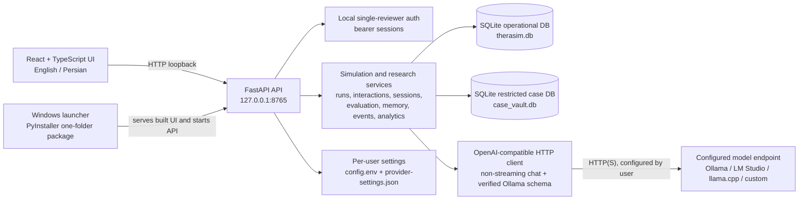

# TheraSim Project Architecture

**Verified against source:** 2026-11-21
**Application version:** 0.3.0

## System overview

TheraSim is a local-first research and educational prototype for practising
psychotherapy skills with fictional client scenarios. ACT is the only runnable
modality. It is not a clinical system and does not establish therapeutic,
psychometric, or clinical validity.

The desktop application binds the web server to `127.0.0.1`, defaults to port
`8765`, serves the production React assets from the package, and opens the
system browser. The API can also be run in a development setup; the desktop
launcher is the packaged runtime entry point.

## Runtime and data flow

1. `backend/app/desktop.py` reads an allow-listed per-user `config.env`,
   selects an available loopback port, prepares application-data directories,
   and starts Uvicorn.
2. `backend/app/main.py` creates the FastAPI application. Startup loads
   provider settings, applies migrations to both SQLite databases, and
   constructs service objects. The API can start without a configured model.
3. Authentication endpoints initialize or sign in one local reviewer.
   Simulation, provider, support, update, and other application routes require
   the bearer-session dependency.
4. `frontend/src/` implements the React and TypeScript interface. The UI stores
   the selected language in browser local storage and sets the document
   language/direction for English LTR and Persian RTL.
5. Services use the explicit persistence repositories and versioned SQL
   migrations. The operational database and restricted case database are
   separate SQLite files; both remain local and unencrypted at rest.
6. Patient, evaluator, and memory-extraction agents share the configured
   provider client but can use separate patient and evaluator model IDs.
   Memory extraction follows the patient model. Blank role overrides fall back
   to the provider's general model. Requests use the OpenAI-compatible `/v1`
   API and only reach the configured endpoint. Ollama evaluator calls include
   strict JSON Schema constraints; application schema and evidence checks
   still run independently. A remote endpoint is possible only when the user
   explicitly disables local-only mode and confirms remote endpoints.
7. Optional hardware inventory runs only when requested through the protected
   `GET /api/v1/llm/hardware` endpoint. It does not run during startup, select a
   model, download weights, or send inventory elsewhere. The endpoint avoids
   probing a non-loopback Ollama URL and labels model compatibility as
   unverified until the exact model/provider/context is tested.

## Configuration and storage

| Purpose | Windows location / setting |
|---|---|
| Application data root | `%LOCALAPPDATA%\TheraSim` |
| Operational database | `%LOCALAPPDATA%\TheraSim\data\therasim.db` |
| Restricted case database | `%LOCALAPPDATA%\TheraSim\data\case_vault.db` |
| Logs | `%LOCALAPPDATA%\TheraSim\logs\therasim.log` (rotated) |
| Allow-listed optional environment config | `%LOCALAPPDATA%\TheraSim\config.env` |
| Saved provider settings | `%LOCALAPPDATA%\TheraSim\provider-settings.json` |
| Default local Ollama base URL | `http://127.0.0.1:11434/v1` |
| Default desktop port | `127.0.0.1:8765` (`THERASIM_PORT` can override it) |

On Windows, saved provider keys are protected with the current user's DPAPI
context. This does not encrypt the live SQLite databases or protect against
malware or another process running as the same user. Provider secrets are
redacted from API settings responses and are not included in support exports.

## Repository map

| Path | Purpose |
|---|---|
| `backend/app/api/routes/` | FastAPI routes and request/response validation |
| `backend/app/core/` | Runtime configuration, paths, credentials, provider settings |
| `backend/app/llm/` | Provider client, patient/evaluator/agent prompts and output parsing |
| `backend/app/services/` | Simulation, evaluation, memory, review, analytics and update workflows |
| `backend/app/persistence/` | SQLite manager, repositories, migrations, backup/restore |
| `backend/tests/` | Backend API, persistence, lifecycle and domain tests |
| `frontend/src/features/` | UI areas for simulation, sessions, review, settings and analytics |
| `frontend/src/i18n.ts` | Shared English/Persian application catalog |
| `frontend/tests/` | Localization, provider-settings, support and download helper checks |
| `scenarios/`, `rubrics/`, `research/` | Fictional research scenarios, ACT rubrics and references |
| `localization/` | Other localized project resources |
| `packaging/windows/` | PyInstaller spec and pinned build dependencies |
| `scripts/` | Windows build/verification, launch and developer utilities |
| `config/model-compatibility.json` | Machine-readable, machine-specific model smoke-test evidence |
| `docs/` | Architecture, research, data, security and release documentation |

## Windows packaging

The Windows build compiles the React app and bundles the Python backend as a
PyInstaller one-folder application. The ZIP contains the EXE, runtime
dependencies, frontend resources, rubric data, and the explicit SQL migration
files. User settings, databases, logs, backups, and model weights are outside
the package and are not replaced during startup. The distribution is not a
single-file executable; it is a portable directory inside a ZIP. Building it
requires Python 3.13 x64 and Node.js 22+, but running a successfully built
package does not require either developer runtime.

The package and smoke-test workflow is defined in
[`scripts/build-windows.ps1`](../scripts/build-windows.ps1),
[`scripts/verify-windows-package.ps1`](../scripts/verify-windows-package.ps1),
and [`.github/workflows/windows-package.yml](../.github/workflows/windows-package.yml).
No model weights are bundled.

The package is built for Windows x64. Windows 11 Pro x64 is the only
development environment exercised for this audit; a minimum Windows version,
other architectures, CPU-only systems, and other hardware tiers have not
been verified. No GPU is required to launch the application. Inference
acceleration and model fit depend on the selected provider and model.
The fresh `TheraSim-v0.3.0-Windows-x64-Portable.zip` passed isolated startup,
UI, local-account persistence, graceful-shutdown, and one synthetic local
Ollama chat check on that same workstation. See the
[v0.3.0 integration audit](V0.3.0_FINAL_INTEGRATION_AUDIT.md) for the package
checksum and test evidence. Physical network-disconnected and clean-machine
tests were not performed.

## Important boundaries

- A model is not bundled or mandatory for application startup. Patient
  generation and model-based evaluation require an available provider/model.
- Local-first does not mean every user-selected provider is local or that all
  installation/download tasks work without internet. See
  [Ollama setup](OLLAMA_SETUP.md).
- The application has a single local reviewer account, not multi-user
  authorization or password recovery.
- ACT rubrics and generated reports are experimental and require human review.
- Databases and backups are user data. Updating or extracting a new app version
  must not be used as a data-cleanup operation.

See the [repository audit](REPOSITORY_AUDIT.md), [security audit](SECURITY_AUDIT.md),
[release audit](RELEASE_AUDIT_v0.3.0.md), [installation guide](INSTALLATION.md),
and [user guide](USER_GUIDE.md) for current evidence and usage guidance.
