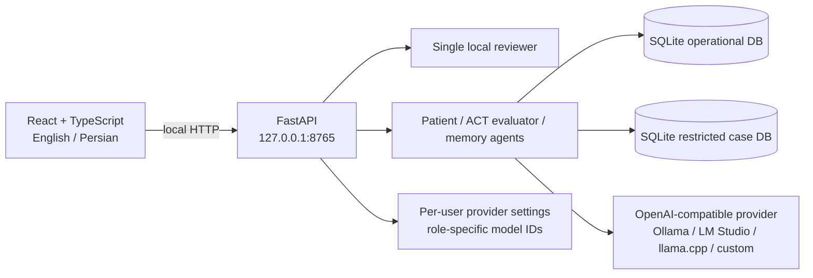

# TheraSim v0.3.0 — Final integration audit

**Audit date:** 2026-11-21
**Source branch:** `release-fix`, based on `origin/main` at
`2995285ef550312793aacd75d5a40031310198f0`
**Scope:** source integration, localization, provider/model configuration,
security and dependency checks, and a fresh Windows x64 portable build.

This report records observed behavior, not clinical or psychometric
validation, security certification, or universal hardware compatibility.

## Scope correction for v0.3.1 evidence

The archive and benchmark values below describe the v0.3.0 audit and a
historical run. They are not the 2026-11-22 v0.3.1 rerun. The public
v0.3.1 asset is 25,212,406 bytes with SHA-256
`1431c9610692f365af396188a68ba72c667b03e741b3ff7ad293758ecea60608`; it
was separately verified after the package verifier was repaired. The
26,345,293-byte archive is a different archive and must not be substituted
for the public v0.3.1 asset.

## Architecture

The Windows one-folder runtime serves the built UI and local FastAPI service.
Patient and evaluator roles can use separate model IDs against the configured
provider; an empty role override falls back to that provider's general model.
Memory extraction uses the patient model. Agent instances load provider
settings at startup, so a restart is required after changes.

Ollama requests may include a strict JSON Schema, but application-side ACT
report, rubric coverage, message/speaker, and exact transcript-quote
validation remains mandatory. Invalid reports are rejected. Structured output
is not a reliability guarantee.

## Version and localization

- Backend application metadata, frontend package and lock, health response,
  Windows package manifest, and release build target are aligned to `0.3.0`.
- English and Persian are integrated in shared UI, provider settings, update
  information, support diagnostics, and user-facing guides.
- A localization-test placement bug that repeated fallback and preference
  tests once per localized feature file is fixed. Each behavior is now
  registered once.
- The manual update checker now accepts the new portable asset name while
  continuing to recognize the existing legacy Windows ZIP name.

## Validation evidence

### Automated checks

| Check | Result |
|---|---|
| Backend, Python 3.13.9, from `backend/` | 507 passed |
| Frontend tests | 18 passed |
| Frontend ESLint | Passed |
| Frontend TypeScript and Vite production build | Passed |
| Backend and Windows packaging dependency audits (`pip-audit`) | No known vulnerabilities reported |
| Full frontend dependency audit (`npm audit --audit-level=moderate`) | 0 vulnerabilities |
| Bandit 1.9.2 over `backend/app` | 11 findings: 0 high, 6 medium, 5 low; see security audit |

### Fresh Windows package

- Built from the current source on Windows 11 Pro x64 using Python 3.13.9 and
  Node.js 26.13.0. The output was written to a new temporary directory; the
  existing `dist/` packages were not overwritten.
- Artifact: `TheraSim-v0.3.0-Windows-x64-Portable.zip`, a one-folder ZIP
  containing a portable application directory, not an installer or
  single-file executable.
- Size: `26,345,293` bytes.
- SHA-256:
  `df1be242f0040b67b9b15ad7e7d7f52e136ed260f690f79370716200d9715319`.
  The `.sha256` sidecar and JSON manifest match the archive.
- Archive review found 1,110 entries, one top-level `TheraSim/` directory, 19
  SQL migration files matching the source allowlist, and no database, SQLite
  sidecar, backup, `.env`, provider-settings, API-key, or model-weight files.
  No absolute or parent-traversal archive paths were found.
- The package verifier passed with system-only `PATH`: startup, UI delivery,
  synthetic local-account initialization, persistence across restart and
  replacement-directory extraction, graceful shutdown, and no remaining
  listener.
- The same verifier connected the packaged app to the already-installed local
  Ollama `qwen2.5:3b` model and completed one fictional synthetic chat. This
  verifies a local chat smoke path only; it is not an ACT evaluator result.
- No existing user database or patient data was read. The package does not
  include model weights.

### Model and hardware evidence

Hardware inventory on this machine reported Windows 11 Pro build `10.0.26300`,
15.6 GiB visible RAM, a 12th Gen Intel Core i7-12650H (10 cores / 16 logical
processors), and an NVIDIA RTX 3060 Laptop GPU with 6 GiB VRAM, plus Intel UHD
graphics. This differs from the earlier hardware assumptions and is the only
machine covered here.

The historical checked-in benchmark records seven schema-valid PatientAgent
responses from `qwen2.5:3b`. In that separate run, the ACT EvaluatorAgent
passed 4 of 6 repeated benchmark reports; two failed exact transcript-quote
validation. Two additional structured reports passed, but this limited evidence
does not establish reliability. The 2026-11-22 rerun is reported separately
and gave 2/6 strict evaluator successes for Qwen2.5. No evaluator model is recommended. Hardware estimates
do not select or guarantee a model fit. See
[`LOCAL_AI_MODEL_EVALUATION.md`](LOCAL_AI_MODEL_EVALUATION.md) and
[`config/model-compatibility.json`](../config/model-compatibility.json).

## File-level integration review

The release changes are limited to the following project files; no database,
backup, log, model weight, local provider configuration, or generated package
is included in the source commit.

| Area | Reviewed files |
|---|---|
| Workflow, ignore rules, and project entry points | `.github/workflows/windows-package.yml`, `.gitignore`, `README.md`, `CHANGELOG.md`, `BUILD_WINDOWS.md`, `INSTALL_WINDOWS.md` |
| Backend provider, runtime, and API | `backend/app/api/routes/llm.py`, `backend/app/api/routes/updates.py`, `backend/app/core/config.py`, `backend/app/core/credential_store.py`, `backend/app/core/hardware.py`, `backend/app/core/provider_settings.py`, `backend/app/desktop.py`, `backend/app/llm/client.py`, `backend/app/llm/evaluator_agent.py`, `backend/app/main.py`, `backend/app/services/update_metadata.py` |
| Backend regression tests | `backend/tests/test_app_lifespan.py`, `backend/tests/test_desktop.py`, `backend/tests/test_evaluator_agent.py`, `backend/tests/test_hardware.py`, `backend/tests/test_health.py`, `backend/tests/test_llm_api.py`, `backend/tests/test_llm_client.py`, `backend/tests/test_provider_config.py`, `backend/tests/test_provider_settings_env.py`, `backend/tests/test_runs_api.py`, `backend/tests/test_support_export.py`, `backend/tests/test_update_metadata.py` |
| Frontend app, localization, and feature integration | `frontend/package.json`, `frontend/package-lock.json`, `frontend/src/App.css`, `frontend/src/App.tsx`, `frontend/src/i18n.ts`, `frontend/src/lib/api.ts`, `frontend/src/types.ts`, `frontend/src/features/analytics/RunAnalyticsPanel.tsx`, `frontend/src/features/auth/AuthPage.tsx`, `frontend/src/features/evaluations/EvaluationPanel.tsx`, `frontend/src/features/evaluations/EvaluationReviewPanel.tsx`, `frontend/src/features/evaluations/LongitudinalEvaluationPanel.tsx`, `frontend/src/features/events/EventReviewPanel.tsx`, `frontend/src/features/localizedValues.ts`, `frontend/src/features/memories/MemoryReviewPanel.tsx`, `frontend/src/features/sessions/SessionsPage.tsx`, `frontend/src/features/settings/SupportExport.tsx`, `frontend/src/features/treatmentPlans/TreatmentPlanPanel.tsx` |
| Frontend helper modules and tests | `frontend/src/lib/downloadTools.js`, `frontend/src/lib/downloadTools.d.ts`, `frontend/src/lib/providerSettings.js`, `frontend/src/lib/providerSettings.d.ts`, `frontend/src/lib/supportDiagnostics.js`, `frontend/src/lib/supportDiagnostics.d.ts`, `frontend/tests/downloadTools.test.mjs`, `frontend/tests/i18n.test.mjs`, `frontend/tests/providerSettings.test.mjs`, `frontend/tests/support.test.mjs` |
| Packaging, benchmark, and observed compatibility evidence | `scripts/build-windows.ps1`, `scripts/verify-windows-package.ps1`, `scripts/benchmark_agent_workflows.py`, `scripts/benchmark_ollama.py`, `config/model-compatibility.json` |
| Architecture, audits, release, localization, installation, and user docs | `docs/PROJECT_ARCHITECTURE.md`, `docs/REPOSITORY_AUDIT.md`, `docs/RELEASE_AUDIT_v0.3.0.md`, `docs/RELEASE_CHECKLIST.md`, `docs/RELEASE_NOTES_v0.2.1.md`, `docs/RELEASE_NOTES_v0.3.0.md`, `docs/SECURITY_AUDIT.md`, `docs/SECURITY_AUTHENTICATION_AUDIT.md`, `docs/SECURITY_SCAN_NOTES.md`, `docs/I18N_GUIDELINES.md`, `docs/TRANSLATION_GLOSSARY.md`, `docs/LOCAL_AI_MODEL_EVALUATION.md`, `docs/INSTALLATION.md`, `docs/INSTALLATION.fa.md`, `docs/USER_GUIDE.md`, `docs/USER_GUIDE.fa.md`, `docs/OLLAMA_SETUP.md`, `docs/OLLAMA_SETUP.fa.md`, `docs/TROUBLESHOOTING.md`, `docs/TROUBLESHOOTING.fa.md`, `docs/V0.3.0_FINAL_INTEGRATION_AUDIT.md` |

Private `.goals/` process artifacts were excluded from the release source tree,
preserved locally, and added to `.gitignore`. Their earlier tracked versions
remain in the pre-existing public Git history; this change does not rewrite
that history. Ignored local databases, backups, logs, caches, virtual
environments, and existing `dist/` artifacts were left untouched.

## Boundaries and remaining checks

- Windows 11 x64 is the only packaged runtime environment tested. No clean
  Windows VM, additional hardware, physically disconnected network, or
  non-Windows credential-storage test was performed.
- The full npm audit and Python backend/build dependency audits report no known dependency
  vulnerabilities at scan time. Bandit reports the findings above; no
  findings were suppressed. This is not a penetration test or independent
  security review.
- Live SQLite data is not encrypted at rest. The local reviewer account is
  not multi-user authorization. A remote model endpoint may receive prompts
  only after local-only restrictions are disabled and remote use is
  explicitly confirmed.
- ACT is the only runnable modality. Evaluator, rubric, analytics, simulated
  responses, and clinical/psychometric validity are not established.
- Release metadata checking is manual and read-only; it does not install
  updates. Model weights are not bundled.

The report does not imply a release exists; publication status is determined
by the repository's GitHub Releases page and completed workflow evidence.
